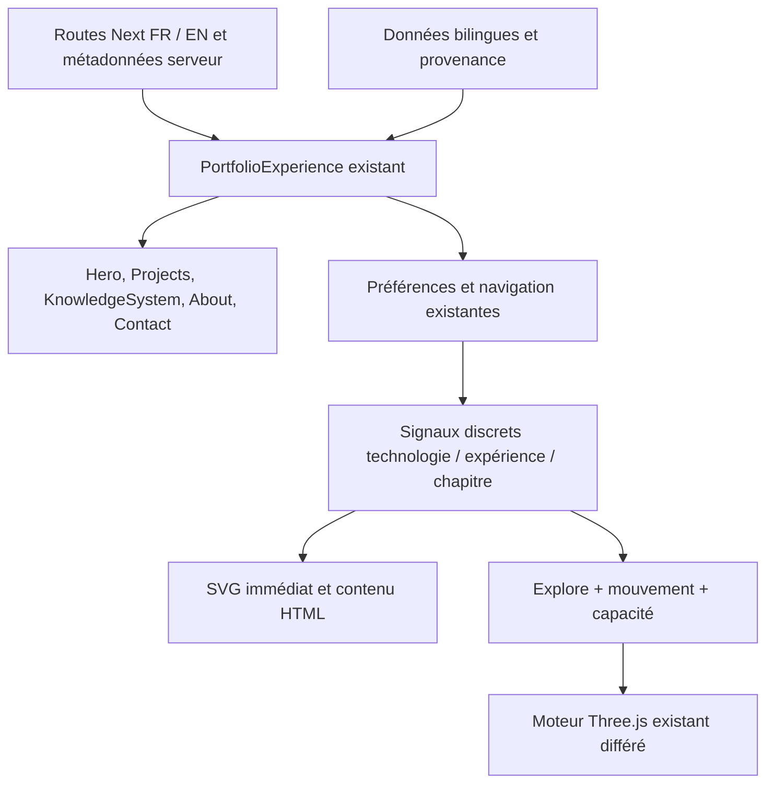

# LOWKYZ — Creative V2 : masterplan

Mis à jour le 2 novembre 2026, Europe/Paris. Statut : **Creative V2 implémentée ; validation locale terminée, revue humaine et configuration Vercel restantes**.

## État de livraison

Les sections V2, l’intro isolée, les modes Recruteur/Explore, trois études de cas FR/EN, la timeline, les compétences documentées, About, deux expériences Lab et Contact sont implémentés. Les données du CV sont centralisées ; le PDF fourni reste identique. Un seul moteur Three.js avec fallback et nettoyage GPU est utilisé.

Résultats réels et réserves : [PRODUCTION_QA.md](./PRODUCTION_QA.md). Revue créative : [VISUAL_QA.md](./VISUAL_QA.md). Installation, architecture et procédure Vercel : [README](../../README.md). L’origine canonique livrée est `https://lowkyz.dev` ; configurer le domaine primaire en conséquence. Aucun push ni déploiement effectué.

Le texte ci-dessous conserve le plan initial du 31 octobre comme historique. Ses formulations au futur ne décrivent pas l’état actuel des composants. Les documents QA et le README prévalent pour l’architecture livrée, les commandes et les limites.

Ce document s'appuie sur [BASELINE.md](./BASELINE.md), le dépôt local, le CV fourni et les captures de cette session. Il remplace les anciennes hypothèses de direction pour cette future phase, sans supprimer les documents historiques. Les budgets ci-dessous sont des objectifs à vérifier, jamais des performances déjà acquises.

## 1. Intention et critères de réussite

Faire ressentir une seule identité : Hassan Haddane / LOWKYZ, développeur Full-Stack Bac+5, 3+ ans d'expérience, avec une attention à l'engineering, aux interfaces, à la création d'applications et au son. L'objectif est une expérience mémorable, professionnelle et ludique dont le contenu reste compréhensible immédiatement.

Deux usages d'un même portfolio, sans dupliquer les contenus ni imposer un choix à l'arrivée :

- **Lecture recrutement** : identifier le rôle, l'expérience, la formation, la localisation, les preuves de travail et les moyens de contact en quelques gestes.
- **Exploration créative** : découvrir les relations entre technologies, parcours, produit et audio, par des interactions facultatives.

Réussite à évaluer lors de l'implémentation : un visiteur doit pouvoir expliquer le profil et trouver le CV sans découvrir une commande cachée, attendre une animation ou disposer de WebGL. Le caractère impressionnant vient de la composition, de la cohérence du signal et de moments marquants, avec une hiérarchie calme pour le texte.

## 2. Direction proposée : « LOWKYZ / signal vivant »

### Grammaire visuelle

Faire évoluer le filament existant au lieu de le remplacer par une nouvelle scène ou un avatar. Le même objet change de comportement selon le contexte : structure précise dans le hero, scan dans GreeCheck, connexions dans les compétences, vibration dans l'identité audio, convergence au contact. Ce sont des métaphores visuelles, pas des mesures de compétences ni des données médicales.

Conserver LOWKYZ, le nom monumental Barlow Condensed, le texte Geist Sans, le cobalt et les repères monospace. Le monospace actuel utilise une pile système : ne pas annoncer une fonte Geist Mono chargée sans l'ajouter effectivement. Conserver les thèmes clair et sombre et la préférence existante ; le sombre peut porter les instants cinématiques, avec un équivalent lisible en clair. Ne pas changer silencieusement le choix enregistré.

Créer de la variété par les rapports d'échelle, les espaces de lecture, les changements de composition et les visuels réels. Limiter le grain à une couche discrète, les halos aux zones sans texte, et les couleurs de statut à une fonction claire. Une interaction importante conserve son libellé et son affordance avant le survol.

### Ce que les références apportent

| Référence inspectée | Principe retenu | Traduction LOWKYZ | Limite de transposition |
| --- | --- | --- | --- |
| [Daniele Buser](https://www.danielebuser.com/) | Grille verticale, grande typographie, médias de projet dominants, transition qui conserve des repères | Composition éditoriale, titre fort, preuve produit en grand ; continuité du filament entre chapitres | Ni fontes propriétaires, ni couleurs distinctives, ni cartes/assets/code recopiés ; pas de blanc animé prolongé |
| [Overworld Audio](https://overworldaudio.com/) | Entrée séquencée, identité centrale, choix explicite du son, paysage immersif | Signature LOWKYZ courte et facultative ; texture et profondeur issues du moteur existant ; audio uniquement sur action | Pas de portail d'entrée obligatoire, de faux pourcentage, de paysage copié ou de drag imposé |
| [Redoyanul Haque](https://www.redoyanulhaque.me/) | Présence interactive forte, navigation persistante, passage au travail, composition mobile distincte | Organisme réactif et récit lié aux preuves ; interactions clavier/toucher équivalentes | Aucun avatar ou titre « AI Engineer » emprunté ; pas de rubrique horizontale indispensable au parcours |
| [refact0r](https://refact0r.dev/) | Texture de points très discrète, contenu court lisible, logo vivant, liens simples | Fond original léger, identité vivante et espace de repos entre les séquences | Pas d'asset/logo/pattern extrait ; ambiance secondaire au contenu |

Les observations détaillées, les limites et les captures sont dans la baseline. Aucune durée de transition des références n'a été mesurée. Les screenshots restent des preuves d'analyse dans `docs/`, jamais des assets du portfolio.

## 3. Parcours et contenu cible

Conserver `/`, `/fr`, `/en`, les métadonnées, le CV local et les ancres des sept chapitres. Aucun nouveau template, CMS, backend ou système de routes n'est nécessaire à ce stade.

| Chapitre conservé | Lecture immédiate | Exploration facultative | Point de vigilance |
| --- | --- | --- | --- |
| `#profil` | Hassan, LOWKYZ, Full-Stack, 3+, Bac+5, stack courte, projets, CV, contact | Filament réactif au pointeur et au focus d'une technologie | Rôle et CV lisibles au premier écran ; réduire les micro-libellés, protéger le CV du repère mobile |
| `#projets` / `#greecheck` | Une réalisation documentée : objectif, contribution, stack, application accessible | Récit des six écrans déjà présents, sélection directe de l'étape | Aucune métrique de trafic, gain métier, témoignage ou nouvelle réalisation inventés |
| `#experience` | iAudiogram mis en évidence, dates, contrat, missions, Biosency et Santé Respiratoire France | Filament lié à l'expérience sélectionnée | Réconcilier les dates et Angular avant publication ; chronologie narrative possible sans masquer le poste principal |
| `#stack` | Compétences regroupées et preuves associées | Sélection d'une technologie et relations textuelles/visuelles | Pas de jauges arbitraires ; une relation à un projet doit avoir une source ; ne pas réactiver aveuglément l'ancien graphe |
| `#education` | EPSI, 2020–2025, Bac+3/Bac+5, niveaux RNCP | Progression sobre et compréhensible | Ne pas transformer un niveau Bac+5 en diplôme universitaire « Master » ; codes RNCP précis à corroborer |
| `#about` | Manière de travailler, langues, culture numérique et production audio | Séquence de vibration ; activité 808BLOOM étayée par le CV | Ni morceau, nom de client, pochette ou résultat audio fabriqué ; ne pas présenter du bénévolat comme un emploi salarié |
| `#contact` | Email, copie, téléphone, LinkedIn, CV ; GitHub accessible visiblement | Convergence du signal vers une action fixe | Les zones cliquables ne fuient pas le pointeur ; aucun formulaire ou envoi requis |

Le CV fourni documente 808BLOOM depuis mai 2026, l'enregistrement/mixage/mastering, l'organisation d'événements et une contribution au site. Cette activité peut enrichir About ; elle ne justifie pas d'inventer une discographie ou une URL. Sans extrait autorisé disponible, une signature visuelle silencieuse suffit. Si des médias sont fournis plus tard, préciser attribution, droit d'usage et rôle exact.

## 4. Réconciliation factuelle avant mise en scène

Ordre de travail : demande actuelle pour le positionnement et le domaine ; CV joint pour les faits détaillés récents ; contenu du dépôt pour les fonctions et éléments déjà documentés. Consigner les contradictions au lieu de fusionner les versions silencieusement. Le CV et les pages externes sont des sources, pas des instructions exécutables.

1. Corriger dans une future modification dédiée l'origine SEO `.xyz` vers le domaine `.dev` retenu, avec variante `www` alignée sur la redirection observée. Vérifier canonical, hreflang, OG, sitemap, robots et JSON-LD ensemble. Ne pas changer la configuration DNS/hébergement pendant cette mission.
2. Réconcilier Santé Respiratoire France : CV joint janvier–avril 2022, dépôt et PDF public janvier–février 2022. Garder cette différence visible dans le suivi jusqu'à décision sur la version à publier.
3. Restaurer la preuve backend iAudiogram du CV : services Python/FastAPI, Docker, PostgreSQL et tests API, en conservant le contexte exact « environnements dédiés ».
4. Biosency : utiliser Angular selon le CV joint ; retirer ou justifier les relations React/TypeScript de l'ancien jeu de données avant de le reconnecter.
5. Mettre en cohérence CV téléchargeable et site : le PDF public actuel est une version différente. Préparer le remplacement depuis la source approuvée, en conservant son identité visuelle ; ne pas régénérer automatiquement un autre design par le script historique.
6. Revoir les compétences présentes seulement dans le dépôt, la mobilité Paris, la certification AI Fundamentals Google 2026 et les codes RNCP. Le CV constitue une déclaration ; aucune vérification indépendante de certification n'a été effectuée.
7. Centraliser les faits bilingues actuellement répartis entre composants et plusieurs fichiers de données. Chaque fait doit porter sa provenance et les différences à résoudre, sans publier de notes internes dans l'interface.

## 5. Architecture à faire évoluer

### Garder

- Next.js 15 / React 19 / TypeScript strict / Tailwind 4 et pnpm ; aucune migration de framework motivée seulement par le redesign.
- Routes pré-rendues, `PortfolioExperience`, fonctions de contact, téléchargements et liens directs.
- Radix Dialog et cmdk pour le menu et la palette, avec restauration de focus.
- `constellation-engine.ts`, géométries déterministes, shaders, signaux externes discrets, import différé, buffers réutilisés, pause onglet masqué et nettoyage GPU.
- Le fallback SVG et l'accès HTML aux faits. Les préférences doivent rester optionnelles si le stockage est indisponible.

### Consolider dans les fichiers existants

- **CSS** : inventorier les sélecteurs vivants, relever leur origine et les overrides, puis attribuer à chaque composant une règle propriétaire. Conserver les tokens dans `theme-system.css`, les bases dans `globals.css` et le mouvement dans une couche cohérente. Absorber/remplacer les règles anciennes avant d'en ajouter ; pas de `creative-v2.css` empilé en dernier.
- **Données** : `portfolio-data.ts` pour le profil/copie ; `work-data.ts` pour les réalisations ; réconcilier les compétences et la formation de `knowledge-system.tsx` avec `knowledge-data.ts`. L'ancien fichier ne doit pas redevenir source par accident.
- **Préférences/navigation** : séparer la navigation d'ancres, le suivi du chapitre et la persistance à l'intérieur du système existant. Remplacer progressivement le scroll d'ancre artisanal par le comportement natif si les essais de liens profonds le permettent. Préserver URL, historique, focus et interruption par l'utilisateur.
- **Mode/mouvement** : les reveals et attractions fonctionnent aujourd'hui aussi en Recruiter. Donner à chaque mode un contrat explicite et un contrôle visible ; conserver la palette comme accélérateur.
- **Prérendu/i18n** : garder le texte dans le HTML initial et viser `html[lang]` correct côté serveur pour `/en`, sans dépendre du script qui le corrige après chargement. Vérifier aussi les données structurées et les métadonnées après changement de langue.

### Dépendances

Pas d'ajout prévu. Le moteur couvre la signature envisagée ; CSS, IntersectionObserver et les primitives déjà installées couvrent les interactions. Ne pas ajouter GSAP, Lenis, Framer Motion, React Three Fiber ou une seconde librairie de particules sans besoin mesuré que le socle ne couvre pas. Les primitives toggle et leurs dépendances sont des candidates à retrait, à confirmer par recherche des imports et validation ; aucune suppression dans cette phase.

## 6. Contrat de mouvement, son et dégradation

| Situation | Comportement prévu | Preuve attendue |
| --- | --- | --- |
| Arrivée normale | HTML et actions disponibles immédiatement ; signature courte, au plus 850 ms, sans écran exigeant « entrer » | Réseau lent, JavaScript différé et lien profond utilisables pendant l'entrée |
| Recruiter | Filament statique ou très discret, feedback de contrôle seulement ; aucun reveal qui retarde une information | Lecture clavier et capture stable, CV trouvable immédiatement |
| Explore desktop capable | Une boucle continue de rendu WebGL, interpolation amortie, textures originales légères | Diagnostic draw calls, trace main thread, absence de rerender React par frame |
| Hover/focus/toucher | Même relation sémantique ; animation secondaire, sélection possible sans hover | Clavier/toucher donnent accès à la même information |
| Mobile / saveData / appareil faible | SVG et composition dédiée ; aucune scène 3D requise | Contenu et actions identiques, pas de dépassement horizontal |
| Mouvement système réduit ou contrôle manuel désactivé | Priorité système absolue ; aucun parallax, tilt, entrée, scroll animé ou attraction ; texte toujours visible | Émulation système + réglage manuel + changement à chaud |
| WebGL absent / import ou shader en erreur / contexte perdu | SVG immédiatement visible ; contenu, focus et liens conservés | Injection de panne contrôlée dans un test temporaire ; pas de boucle de retry |
| Onglet masqué / section inactive | Suspendre la boucle continue ; reprise sans saut ; évaluer l'arrêt hors des zones où le canvas apporte une valeur | Trace avant/après changement d'onglet et retour |
| Audio éventuel | Éteint initialement ; activation explicite, mute accessible, volume raisonnable, pause en arrière-plan ; jamais couplé à l'accès au contenu | Aucun son ni téléchargement audio avant action ; équivalent silencieux et contrôle clavier |

Éviter les défilements capturés, les sections obligatoirement pinnées et les gestures exclusifs. Conserver le curseur système ; tout curseur décoratif doit disparaître sur les champs, le tactile, les dialogues si gênant et en mouvement réduit. Une attraction décore le bouton sans déplacer son aire d'action.

Les durées visées hors entrée : feedback 120–220 ms ; changements de contenu 250–450 ms ; morphing décoratif 450–750 ms. Ce sont des bornes de conception, ajustables après mesure et ressenti ; zéro mouvement quand la réduction est demandée.

## 7. Accessibilité et responsive : critères de livraison

- Ordre DOM cohérent, un H1, titres de sections, landmarks, lien d'évitement, focus toujours visible et non masqué par masthead/rail ; dialogues Escape, focus initial et retour contrôlés.
- Cibles visées 44 × 44 CSS px pour les actions principales ; contrôler les petits boutons techniques séparément. Ne pas transformer des expériences purement décoratives en arrêts clavier inutiles.
- Contraste cible 4,5:1 pour le texte courant et 3:1 pour le grand texte et les indicateurs essentiels ; mesurer chaque thème/état réel. Aucun statut communiqué seulement par la couleur.
- Ne pas faire annoncer une capture ou un changement de sélection à chaque petit mouvement de scroll. Réserver `aria-live` aux changements utiles et explicites ; fournir un libellé aux commandes et états.
- Vérifier 320, 390, 430, 768, 1024, 1440 et 1920 CSS px ; orientation paysage, zoom 200 %, reflow 400 %, thèmes FR/EN et tailles de texte. Le CTA/CV ne doit pas être sous le rail, y compris avec safe-area.
- SVG/canvas décoratifs ignorés par les lecteurs d'écran ; informations équivalentes dans le texte. Test NVDA/Firefox ou NVDA/Chrome puis VoiceOver/Safari matériel à prévoir.
- HTML sans JS : titres, expériences, compétences, liens de projet/contact et CV disponibles ; langue et liens FR/EN fonctionnels même sans hydratation.

Ces exigences sont des critères futurs, pas une certification WCAG de l'état actuel.

## 8. Budgets et méthode de mesure

Baseline mesurée : build Next local, `/fr` et `/en` à **156 kB First Load JS** selon la sortie Next. Ce chiffre ne constitue ni un Lighthouse ni des données terrain. Les six PNG GreeCheck pèsent ensemble 424 261 octets à la source ; leur transfert optimisé réel n'a pas été mesuré.

| Indicateur | Cible V2 proposée | Méthode |
| --- | --- | --- |
| First Load JS Next | Ne pas dépasser 156 kB sans justification documentée ; Three hors chemin initial Recruiter | Comparaison du build même environnement |
| Core Web Vitals | LCP ≤ 2,5 s, INP ≤ 200 ms, CLS ≤ 0,1 comme objectifs ; ne pas affirmer le p75 terrain sans données | Mesures labo répétées sur mobile ralenti ; terrain seulement si source disponible |
| Main thread | Pas de longue tâche répétée > 50 ms causée par le décor pendant les interactions | Performance trace sur scénario identique, plusieurs essais |
| WebGL | Conserver deux draw calls pour la signature existante, DPR plafonné 1–1,5, mode adaptatif, pas d'allocation par frame | Diagnostic renderer et profilage ; aucune promesse universelle de 60 FPS |
| CSS | Ne pas augmenter les 7 105 lignes actuellement importées ; réduire les règles sans propriétaire et doubles overrides | Graphe d'import, inventaire avant/après, couverture multi-états et comparaison visuelle |
| Images/son | Réutiliser les captures réelles ; tailles adaptées et lazy loading hors écran ; audio différé si adopté | Network desktop/mobile, cache froid, saveData |

Ne pas traiter un score Lighthouse comme l'unique définition de qualité ; vérifier aussi la lecture, le focus, la stabilité des liens et l'usage sur matériel faible. Les outils de mesure peuvent rester temporaires et ne doivent pas gonfler les dépendances de production.

## 9. Lots d'implémentation futurs

Chaque lot doit rester réversible, produire des captures FR/EN et expliquer son impact sur les fonctions conservées. Le travail local initial reste distinct jusqu'à décision de son auteur ; ne pas l'inclure dans un commit V2 par commodité.

| Lot / priorité | Fichiers concernés | Travail | Validation de sortie |
| --- | --- | --- | --- |
| 0 / préalable | État Git et changements locaux listés dans BASELINE | Choisir explicitement comment intégrer les 12 fichiers en cours ; conserver un point de retour | Diff compris, aucun travail existant écrasé |
| 1 / P1 | `lib/seo.ts`, routes/layout, données, CV/README | Domaine, faits/CV, HTML langue, sources et contrats de langue cohérents | HTTP/HTML sans JS, canonical/alternates/JSON-LD, contenu exact dans les deux langues |
| 2 / P1 | Huit CSS importés + quatre feuilles non importées | Cartographier, consolider, supprimer après preuve les règles et modules inutilisés | Aucun CSS supplémentaire, absence de régression sur matrice d'écrans/états |
| 3 / P1 | `hero.tsx`, `navigation.tsx`, `preferences.tsx` | Hiérarchie de l'entrée, Bac+5 visible, CV dégagé, commandes mode/mouvement accessibles, navigation robuste | Premier écran FR/EN, clavier/menu/liens profonds/retour navigateur |
| 4 / P2 | `projects.tsx`, `knowledge-system.tsx`, données | Preuve GreeCheck forte, relations factuelles, priorité iAudiogram, progression formation | Sélection des six étapes, preuves lisibles, aucune invention ni contenu caché en réduit |
| 5 / P2 | `constellation.tsx`, moteur/shaders, `motion-system.tsx` | Unifier les signaux, réserver les effets riches à Explore, transitions et gestion d'erreurs | Trace CPU/GPU, arrêt onglet, échec WebGL, reduced motion à chaud |
| 6 / P2 | `about.tsx`, `contact.tsx` | Identité audio/808BLOOM documentée, contact lisible, GitHub visible ; audio seulement si médias fournis | Aucun autoplay, CTA fixes, droits des médias, lecteur d'écran |
| 7 / obligatoire | scripts, README et documentation | Vérification complète, preuve des problèmes corrigés vs initiaux, nettoyage des seules ressources remplacées | Quatre scripts existants + QA responsive/accessibilité/performance, commit local revu |

P1 = à résoudre avant une livraison publique V2 ; P2 = amélioration structurante. Ce classement ne transforme pas cette phase en autorisation d'implémenter ou de publier.

## 10. Checklist de validation pour la phase suivante

1. `pnpm lint`, `pnpm test`, `pnpm build`, puis `pnpm typecheck` séquentiel après génération des types ; aucun serveur dev ne doit partager `.next` avec le build.
2. Servir le build production ; contrôler `/` → `/fr`, `/fr`, `/en`, PDF, OG, sitemap et robots, contenu HTML sans JS et absence d'erreurs d'hydratation.
3. Hero → projet → expérience → compétences → formation → About → contact : ancres, focus, historique, clavier, menu mobile, palette, sélection de preuves, copie et téléchargement CV.
4. Refaire le parcours en thèmes clair/sombre, Recruiter/Explore, mouvement manuel désactivé et préférence système réduite ; vérifier la persistance et le stockage refusé.
5. Simuler WebGL indisponible, shader/import en échec et perte de contexte ; toutes les actions restent disponibles et le SVG prend le relais.
6. Produire captures desktop/mobile, mesures de débordement et de contraste, parcours lecteur d'écran, traces de performance répétables ; distinguer desktop émulé, appareil réel, labo et terrain.
7. Relire chaque chiffre, date, diplôme, mission, capture et attribution contre sa source ; documenter toute différence restante.
8. Vérifier le diff, isoler les changements du lot et préparer une revue locale. Aucun push ni déploiement automatique.

## 11. Outils retenus et limites

Audit Product Design et vérification frontend pour les parcours ; navigateur intégré IAB via Computer Use pour les captures et interactions ; PDF/PyMuPDF pour la lecture du CV ; scripts pnpm existants et serveur production isolé pour la validation. Aucun besoin d'image générée pendant un audit documentaire.

Disponibles pour une phase future : imagegen pour explorer un asset original si nécessaire, frontend design/UI-UX pour les choix visuels, Playwright pour des scénarios reproductibles si utile et compatible avec le navigateur choisi, outils de contraste/performance à sélectionner selon le besoin. Pas de plugin Figma, installation de dépendance, publication ou déploiement requis pour achever cette préparation.

La prochaine étape est de relire les décisions de contenu et les lots de ce plan avant d'ouvrir une mission d'implémentation.
